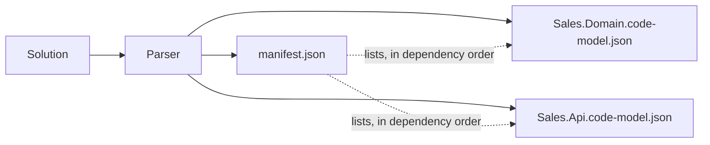
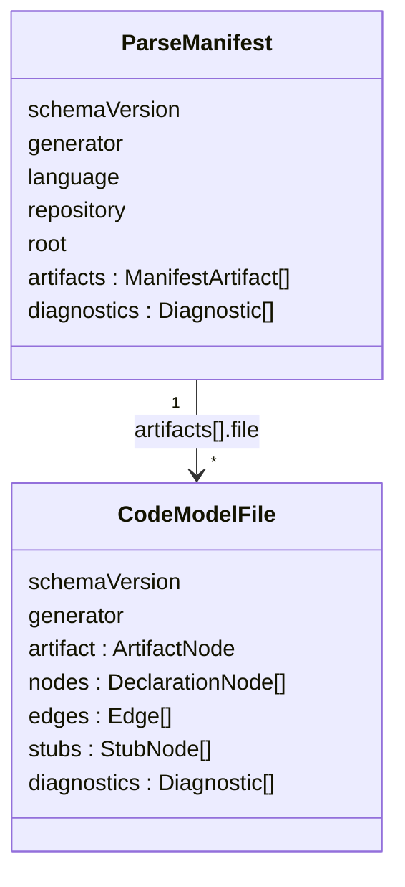
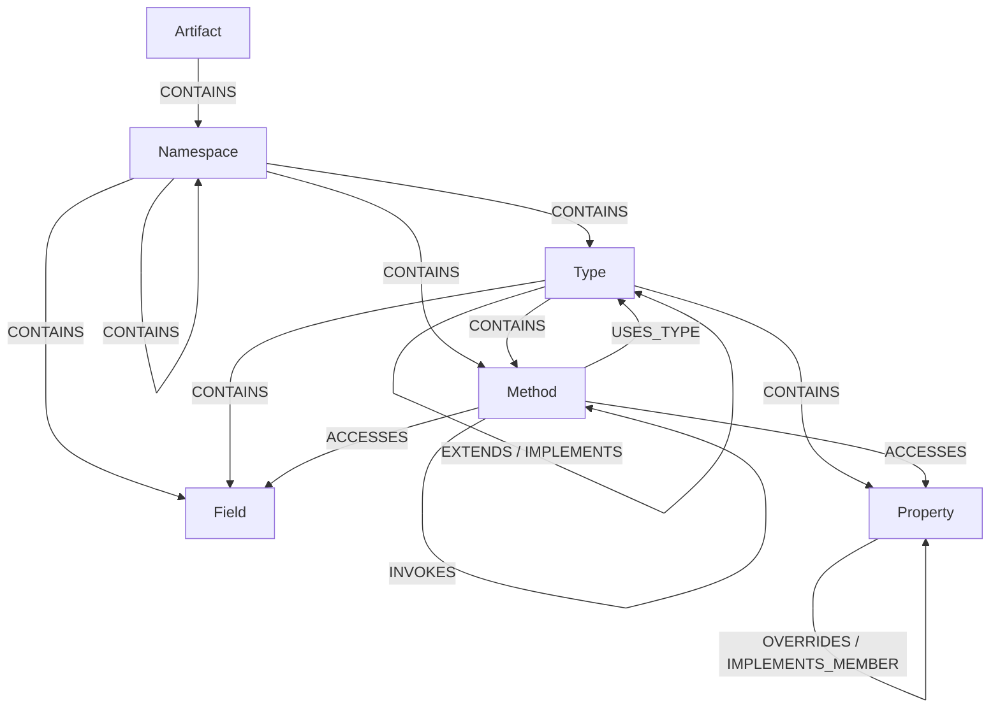
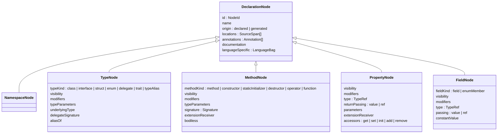
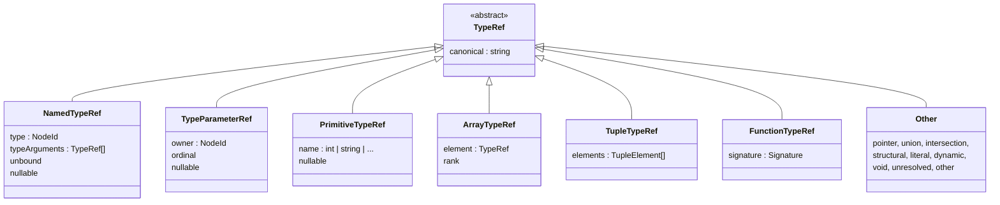
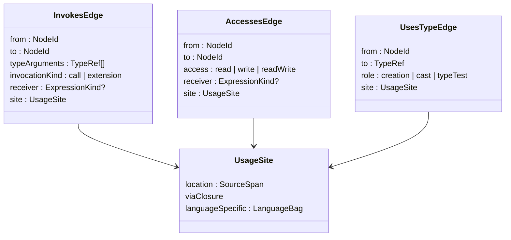
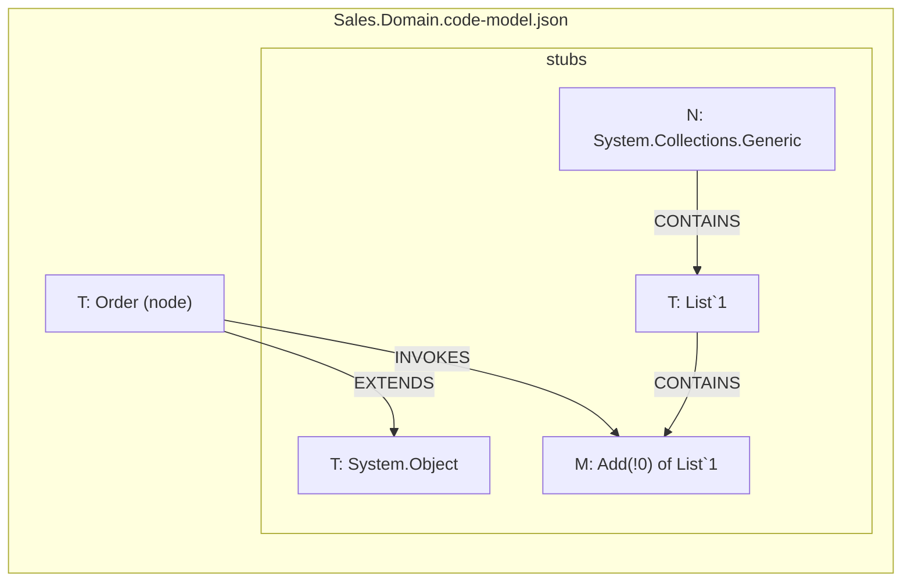

# The code model: a first read

A parser reads one solution and writes a _code model_: a graph of what the
code declares and what each body does, in a vocabulary shared by every
language. This page walks that model top down. The contract is the zod schema
in `server/backend/src/app/scanners/code-parsers/code-model.ts`; the parsers keep their own copies in
`code-parsers/dotnet/src/Noesis.Parser.Model` and `code-parsers/java/model`.

## 1. What a parse produces

One parse covers one solution and writes one directory,
`code-model/<language>/`, under an output root. It holds a **manifest** and
one **model file per artifact**. An artifact is what one build-tool unit
produces: a C# project, a Maven module, an npm package.



The output is temporary. The parser writes to
`.noesis/tmp/parser/` under the repository root unless `--out` says
otherwise; the server points `--out` at a fresh `.noesis/tmp/<uuid>/`, which
git ignores and the server removes once it has read the model.

The manifest is what a consumer opens first. It names the language, the
repository and revision, the parse root, every artifact file in dependency
order, and the diagnostics that belong to the parse as a whole. A model file
repeats only the schema version and the generator, so it can be read on its
own.



Each model file has five parts, and the rest of this page takes them in turn:

| Part          | What it holds                                                                        |
| ------------- | ------------------------------------------------------------------------------------ |
| `artifact`    | The unit itself: name, version, target platform, dependencies                        |
| `nodes`       | Every declaration the artifact makes: namespaces, types, methods, properties, fields |
| `edges`       | Relations between nodes: nesting, inheritance, calls, accesses, annotations          |
| `stubs`       | Minimal placeholders for external symbols the artifact reaches                       |
| `diagnostics` | Compiler and parser problems, with locations                                         |

Every list is sorted, so two parses of the same code produce byte-identical
files.

### Versions

`schemaVersion` is the contract between a parser and the service, and the
only one: the service knows no parser version.

- A **parser** writes one schema version, in the manifest and in every model
  file: `CURRENT_SCHEMA_VERSION` in the Java parser's `ParseManifest`,
  `CurrentSchemaVersion` in the .NET one's. A parser release that moves to a
  new schema is a major release, and its README's compatibility table says
  which schema each release writes.
- The **service** reads one schema version, `CODE_MODEL_SCHEMA_VERSION` in
  `code-model.ts`. Any change to the shape of the model bumps it: the
  schemas are strict, so even an added field is one an older service
  refuses. A unit test keeps the three declarations equal while the parsers
  live in this repository.
- A **scan** reads the manifest's `schemaVersion` and `generator` first,
  before the rest of it, and refuses a schema the service does not read,
  naming both sides and the side to update:
  `noesis-parse-java 2.0.0 wrote code model schema 2; this Noesis plugin reads schema 1. Update the plugin …`
  for a parser ahead, `… Update the parser with the setup-java-scanner skill.`
  for one behind.

A parser release that keeps the schema needs nothing from the service or
the plugin. One that changes it goes first: the plugin release that reads
the new schema follows once that parser is on Maven Central, or every scan
of a freshly set up build would be refused. The skills install the newest
parser release and pin it back by the compatibility table when the plugin
is behind.

## 2. The graph in one picture

The model is a graph. Six node kinds carry the structure; eight edge kinds
carry the relations.



Property and field bodies (accessors, initializers) produce the same
`INVOKES`, `ACCESSES` and `USES_TYPE` edges as method bodies; the picture
shows only the method.

Three ideas organise everything:

- **Declarations are complete.** A node carries every fact about its own
  declaration: visibility, modifiers, type parameters, signature, annotations,
  locations. Nothing about a declaration is spread across edges.
- **Bodies are three facts.** What a method, property or field body does is
  recorded only as `INVOKES`, `ACCESSES` and `USES_TYPE` edges, one per
  site. Nothing is aggregated or inferred.
- **Nothing is guessed.** A site the compiler could not bind produces no
  edge and one diagnostic.

## 3. Identity

Every node has a `NodeId` string:

```
<kind letter>:<canonical path>
```

| Kind      | Letter | Canonical path                                     | C# example                                        |
| --------- | ------ | -------------------------------------------------- | ------------------------------------------------- |
| Artifact  | `A`    | assembly name; external ones add `@` version       | `A:Sales.Domain`, `A:NodaTime@3.3.2.0`            |
| Namespace | `N`    | dotted name, empty for the global namespace        | `N:Sales.Domain.Orders`                           |
| Type      | `T`    | namespace `.` type, `+` for nesting, `` ` ``arity  | ``T:Sales.Domain.Orders.Order+Line`1``            |
| Method    | `M`    | type `#` name `` ` ``arity `(` parameter types `)` | ``M:Sales.Domain.Orders.Order#AddLine`1(int,!0)`` |
| Property  | `P`    | type `.` name; indexers as `this[...]`             | `P:Sales.Domain.Orders.Order.Total`               |
| Field     | `F`    | type `.` name                                      | `F:Sales.Domain.Orders.Order._lines`              |

Parameter types inside a method id use the same canonical grammar as type
references (section 5), so overloads stay distinct and the id never depends
on parameter names. `!0` is the first type parameter of the type, `!!0` the
first of the method. Constructors are `#.ctor`, static initialisers
`#.cctor`, operators `#op_Addition`.

An id carries no language: one parse covers one language, and the manifest
names it. An id is unique **within one artifact file**, not across the parse:
two projects that both declare namespace `Sales.Domain` each have an
`N:Sales.Domain` node. The join key across files is therefore
(artifact, id). An edge or type reference may point at an id its own file
does not declare; the target is looked up in the referencing file first,
then in its dependencies in listed order, then in its stubs.

## 4. Nodes

All five declaration kinds share one base and add their own fields.



Points that surprise a first reader:

- **An event is a property** with `add`/`remove` accessors. An indexer is a
  property with parameters. A constant is a field with `constantValue`.
  An enum member is a field with `fieldKind: enumMember`.
- **A record is a class or struct** with the `record` modifier, not its own
  type kind.
- **Generated members are nodes too.** A default constructor or a record's
  `Equals` is a node with `origin: generated` and no locations, so edges
  can point at it.
- **A free function** (TypeScript, PHP) hangs off its namespace, not off a
  synthetic type.
- **The artifact node** sits outside `nodes`, in `artifact`. It records its
  kind, the name references bind to, the version, the root directory, the
  target platform (`net10.0`), whether it is executable, its dependencies,
  its assembly-level annotations and a `languageSpecific` bag. Each
  dependency is an artifact id plus its kind: `source` for another parsed
  project, `library` for a package, `platform` for the framework.
- **Extension members** carry the extended type in `extensionReceiver`:
  a classic `this` parameter or a C# 14 `extension(...)` block, on methods
  and properties alike.

A `Signature` is parameters, return type, return passing (`value` or `ref`)
and return annotations. A `Parameter` adds passing, `variadic`, `optional`,
a default value and annotations. A `TypeParameter` has an ordinal, variance
and constraints.

Visibility is a closed vocabulary that covers every language: `public`,
`protected`, `private`, `artifact` (C# `internal`), `namespace` (Java
package-private), `file`, and the C# combinations `protectedOrArtifact`
and `protectedAndArtifact`.

## 5. Type references

Wherever a node or edge names a type, it uses a `TypeRef`: a small structural
tree, not a string. The tree is what lets a consumer tell `List<int>` from
`List<string>` without parsing.



Two rules keep the tree small:

- A `named` reference points at a type **by id** and carries its own type
  arguments. Arguments are CLR-flattened: arguments of containing types come
  first, then the type's own.
- A `primitive` reference is a type the language spells with a keyword
  (`int`, `string`, `bool`). `void` and `dynamic` have their own kinds.

Every `TypeRef` has a canonical string, the same grammar the ids use:
``List`1[int]``, `int[,]`, `!0`, `(int,string)`. It is what sorts edges and
what appears inside method ids.

## 6. Edges

Every edge has a `kind` and a `from` node id. What it points at depends on
the kind: a node id when the target is a declaration, a `TypeRef` when the
target is a constructed type.

| Edge                | From → to                              | Target  | Meaning                                                                                                       |
| ------------------- | -------------------------------------- | ------- | ------------------------------------------------------------------------------------------------------------- |
| `CONTAINS`          | Artifact/Namespace/Type → child        | id      | Declaration nesting, one hop                                                                                  |
| `EXTENDS`           | Type → Type                            | TypeRef | Declared base class or base interface                                                                         |
| `IMPLEMENTS`        | Type → Type                            | TypeRef | Directly declared interface                                                                                   |
| `OVERRIDES`         | Method/Property → Method/Property      | id      | Directly overridden member                                                                                    |
| `IMPLEMENTS_MEMBER` | Method/Property → Method/Property      | id      | Interface member this member satisfies, plus the constructed interface and the type that declared the mapping |
| `INVOKES`           | Method/Property/Field → Method         | id      | A call, or an object creation (the target is the constructor)                                                 |
| `ACCESSES`          | Method/Property/Field → Property/Field | id      | A read, write or read-write of a member                                                                       |
| `USES_TYPE`         | Method/Property/Field → Type           | TypeRef | A cast, a type test, or a creation that has no constructor                                                    |

The first five describe structure and carry no location. The last three
are the **body facts**, and each carries a `UsageSite`: the source span,
whether the site is inside a lambda or local function (`viaClosure`), and a
`languageSpecific` bag.



`receiver` says what the call or access was made _on_: `this`, `base`, a
`parameter`, a `local`, a `field`, a `property`, a `type` name, a
`typeParameter` (a static abstract member), a fresh `creation`, the
`returnValue` of another call, a `literal`, or `other`. It is what lets a
consumer tell "calls a repository it holds in a field" from "calls a
repository passed in". Static dispatch is `receiver: type`. A member called
or accessed without a written receiver, `Save()` inside its own class, is
`receiver: this`. `receiver` is null only where there is no receiver at all.

Object creation is one fact: `new Order()` is an `INVOKES` of
`Order#.ctor()` with `receiver: null`, and no `USES_TYPE`. A generic type's
arguments ride on that edge: `new Dictionary<string, Order>()` invokes
``Dictionary`2#.ctor()`` with `typeArguments` `[string, Order]`,
CLR-flattened like a `named` reference. `USES_TYPE` with
`role: creation` is left for creations that call no constructor: an array
(`new int[3]`), `new T()` on a type parameter, an anonymous object.

`invocationKind: extension` marks a call to an extension member: `to` is the
static method that declares it, and `receiver` is the extended value.

One edge per site, never aggregated. Counting is the consumer's job.

## 7. Stubs: the edge of the parsed world

An artifact reaches symbols that no parsed artifact declares: `System.Object`,
`NodaTime.Instant`, `List<T>.Add`. For each such symbol the file carries a
**stub**: id, kind, name, type kind for types, and the external artifact it
belongs to. Nothing else, no visibility, no signature, no members.



Stubs come with their containing types and namespace, and a stubbed type
comes with its base chain, so a consumer can place every reached symbol in
the hierarchy without opening the library. Symbols of other parsed
artifacts are never stubbed: their ids resolve to that artifact's own file.

## 8. The small things

**Annotations.** An `Annotation` is a type reference plus arguments. Every
argument is named by its parameter, so positional and named spellings read
the same. Values are a closed set: `literal`, `type`, `enum`, `array`,
nested `annotation`, or `other`. Annotations live only where they are
declared: in `annotations` of a node, parameter or type parameter, in
`returnAnnotations` of a signature, or on the artifact. There is no
annotation edge.

**Language-specific bag.** The shared vocabulary is closed. Anything that
only one language has goes into `languageSpecific`, a flat,
language-prefixed bag of scalars on the artifact, node, parameter, type
parameter or usage site: `csharp.partial`, `csharp.refKind`,
`java.throws`, `ts.isAmbient`. Unknown keys are allowed and ignored.

**Locations.** A `SourceSpan` is a file path relative to the repository root
and one-based start and end line and column. A node may have several
locations (a partial class, a namespace spread over files) or none (a
generated member).

**Diagnostics.** Severity, a code (`CS0246` from the compiler, `NS1003` from
the parser), a message, an optional location and a `source` of `compiler`
or `parser`. A parser diagnostic is how an unbound site is reported
instead of a guessed edge.

## 9. Reading a file

A method node, and the three edges its body produced, look like this in the
JSON (abbreviated: the node also carries type parameters, annotations,
documentation, `extensionReceiver`, `bodiless` and `languageSpecific`):

```json
{
  "kind": "method",
  "id": "M:Sales.Domain.Orders.Order#AddLine(Sales.Domain.Orders.Product,int)",
  "name": "AddLine",
  "methodKind": "method",
  "visibility": "public",
  "modifiers": [],
  "signature": {
    "parameters": [
      {
        "name": "product",
        "type": {
          "kind": "named",
          "type": "T:Sales.Domain.Orders.Product",
          "typeArguments": [],
          "unbound": false,
          "nullable": false
        },
        "passing": "value"
      },
      {
        "name": "quantity",
        "type": { "kind": "primitive", "name": "int", "nullable": false },
        "passing": "value"
      }
    ],
    "returnType": { "kind": "void" }
  },
  "locations": [
    {
      "file": "src/Sales.Domain/Orders/Order.cs",
      "startLine": 20,
      "startColumn": 5,
      "endLine": 24,
      "endColumn": 6
    }
  ]
}
```

```json
{ "kind": "ACCESSES", "from": "M:...Order#AddLine(...)", "to": "F:Sales.Domain.Orders.Order._lines", "access": "read", "receiver": "this", "site": { "location": { "...": "..." }, "viaClosure": false, "languageSpecific": {} } }
{ "kind": "INVOKES",  "from": "M:...Order#AddLine(...)", "to": "M:System.Collections.Generic.List`1#Add(!0)", "typeArguments": [], "invocationKind": "call", "receiver": "field", "site": { "...": "..." } }
{ "kind": "INVOKES",  "from": "M:...Order#AddLine(...)", "to": "M:Sales.Domain.Orders.Order+Line#.ctor(Sales.Domain.Orders.Product,int)", "typeArguments": [], "invocationKind": "call", "receiver": null, "site": { "...": "..." } }
```

Read it as: `AddLine` reads its own `_lines` field, calls `List<T>.Add` on
that field, and creates an `Order.Line` by calling its constructor. The
`List<T>` method is not declared here, so the file also holds a stub for it,
its type and its namespace.

## 10. What the model deliberately leaves out

No call counts, no transitive closures, no inferred relations, no inherited
members copied down, no local variables, no control flow. Everything here is
one hop and one site, and the consumer composes the rest. Candidate edges
for unbound sites and argument-level facts are deferred.
