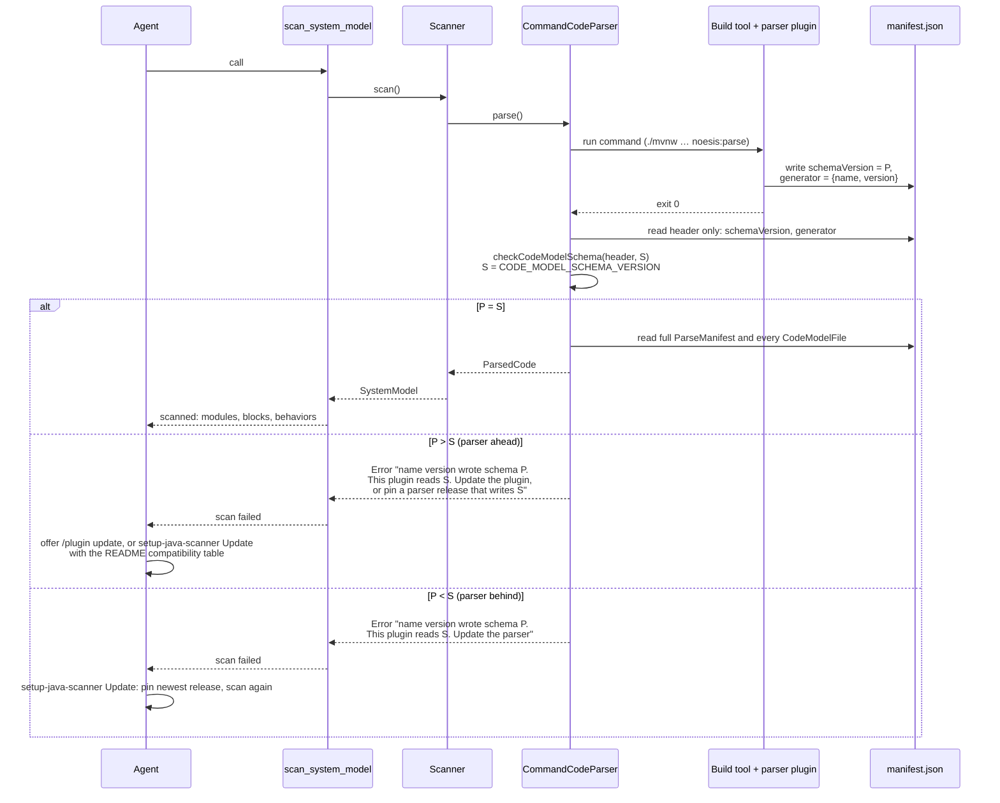

# Plan: the code model schema version as the contract between plugin and parsers

The plugin (`v*` tags, npm) and the Java parser (`java-v*` tags, Maven
Central) already release on their own versions. What ties them together is
the code model: the parser writes it, the service inside the plugin reads it.
That tie is `schemaVersion`, an integer copied by hand into three places
(`server/backend/src/app/scanners/code-parsers/code-model.ts`,
`code-parsers/java/model/.../ParseManifest.java`,
`code-parsers/dotnet/src/Noesis.Parser.Model/ParseManifest.cs`), checked
only as a zod literal deep inside a schema, and never named to the agent.
The parser versions the skills install are literals in `SKILL.md` files that
no release step touches.

This plan, the first phase of the release review of 2026-10-28, makes the
schema version the one explicit contract: a parser declares the schema it
writes, the service declares the schema it reads, and a scan compares the
two by name. The service knows no parser version. A parser release that
keeps the schema touches nothing in the service or the plugin; one that
changes the schema is the only kind the service has to follow. Later phases
(Java `-SNAPSHOT` bump and tests in the release, GitHub Releases, the .NET
parser's release train) build on this and are out of scope here.

## Why

- **A mismatch is unreadable today.** A parser writing schema 2 against a
  service reading 1 fails with `The parser wrote no readable manifest at …:`
  followed by zod's issue list. Nothing says which side is behind or what to
  update.
- **The service must not pin parsers.** Parsers bump for their own reasons
  (a Lombok fix, a Gradle version) far more often than the model changes. A
  table of accepted parser versions in the service would turn every parser
  release into a plugin release. The schema version is the only thing the
  service has a stake in.
- **The skills carry stale literals.** `0.1.0` appears eight times in
  `plugins/claude-code/skills/setup-java-scanner/SKILL.md` and once in
  `implement-java-spring/SKILL.md`. They are the version the skill was
  written against, not a compatibility statement, and nothing updates them.
- **The manifest already says what is needed.** It carries `schemaVersion`,
  `generator.name` and `generator.version`; the check only has to read them
  first and speak.

## The contract

- A **parser** writes one schema version and states it in the manifest and
  in every model file. Its `CURRENT_SCHEMA_VERSION` (Java) and
  `CurrentSchemaVersion` (.NET) are that declaration. A parser release that
  moves to a new schema bumps its major version and says so in its README's
  compatibility table.
- The **service** reads one schema version, `CODE_MODEL_SCHEMA_VERSION` in
  `code-model.ts`. Any change to the shape of the code model bumps it: the
  file schemas are `strictObject`, so even an added field is a change an
  older service refuses. Reading two versions at once is a later design
  (section 6 of `code-model-as-the-only-contract.md` is where it would go).
- A **scan** compares the two before anything else and names both sides,
  with the parser's own name and version from the manifest, so the message
  says what to update without the service knowing any parser version.
- The **skills** install the newest parser release and never carry a
  version; when a scan refuses the schema, the skill reads the parser's
  compatibility table to pick the newest release that writes the schema the
  plugin reads, or tells the user to update the plugin.

## What changes

### 1. The service names the schema it reads

`code-model.ts` gains one exported constant,
`CODE_MODEL_SCHEMA_VERSION = 1`, and its two `schemaVersion: z.literal(1)`
read it. Nothing else in the service learns about parsers.

### 2. The scan checks the schema first and says what it found

In `command-code-parser.ts`, `readCodeModel` reads the manifest in two
steps. First a small schema of just `schemaVersion` (any integer) and
`generator`, then the check, then the full `ParseManifest` schema, so a
mismatch cannot hide behind a hundred unrelated issues:

- parser ahead:
  `noesis-parse-java 2.0.0 wrote code model schema 2; this Noesis plugin reads schema 1. Update the plugin (/plugin update noesis-beta@noesis), or pin the parser to a release that writes schema 1 (its README lists them).`
- parser behind:
  `noesis-parse-java 0.1.0 wrote code model schema 1; this Noesis plugin reads schema 2. Update the parser with the setup-java-scanner skill.`

Each message is an `Error` thrown from the parser, so it reaches the agent
through `scan_system_model` as scan failures do today. The check is a pure
function in the app layer, `checkCodeModelSchema(header, CODE_MODEL_SCHEMA_VERSION)`,
tested on its own. A manifest without a readable header gets the message it
gets today.

### 3. The parsers publish a compatibility table

`code-parsers/java/README.md` gets a short "Compatibility" section with one
table, kept by the release checklist:

| Parser release | Code model schema |
| -------------- | ----------------- |
| 0.1.0          | 1                 |

A row is added at every release; the schema column changes only when the
parser moves to a new schema, which is a major bump. `code-parsers/dotnet/README.md`
gets the same table once the .NET parser has releases (phase 4); until then
it states the schema its checkout writes.

### 4. The skills install the newest release and carry no version

`setup-java-scanner/SKILL.md`:

- The versions table loses its version column. A new step, before editing
  the build, resolves the version: read the `<release>` element of
  `https://repo1.maven.org/maven2/vision/noesis/noesis-parser-maven-plugin/maven-metadata.xml`
  (the Gradle plugin and the annotations release together, so one lookup
  serves all three). Without network access, ask the user for the version.
  Every `0.1.0` in the Maven, Gradle and Kotlin DSL blocks becomes
  `<version>`, defined once as that resolved release.
- A new **Update** section, used when `scan_system_model` reports a schema
  the plugin does not read: for a parser behind, set the pins (`<version>` of
  the plugin and the annotations in `pom.xml`, the `plugins {}` and
  `dependencies {}` lines, or the version catalog) to the newest release and
  scan again; for a parser ahead, read the compatibility table in
  `https://github.com/NoesisVision/noesis/blob/main/code-parsers/java/README.md`
  and pin the newest release that writes the plugin's schema, or offer the
  plugin update. The description line names this trigger so the skill is
  picked when the scan error appears.
- A note that the annotations need not move with the parser: the parser
  reads them by name, so a build may keep an older `noesis-annotations`.

`implement-java-spring/SKILL.md` step 6 resolves the annotations version the
same way instead of naming `0.1.0`. `setup-dotnet-scanner/SKILL.md` is
unchanged: the tool comes from a checkout until phase 4.

### 5. Tests

Service, `test/unit/`:

- `code-model-schema.spec.ts`: both refusals with their exact messages,
  including the parser's name and version taken from the manifest; an equal
  version accepted; a manifest without `schemaVersion` reported as unreadable.
- A guard that the three declarations agree: reads `ParseManifest.java` and
  `ParseManifest.cs` from the monorepo and expects
  `CURRENT_SCHEMA_VERSION = <n>` and `CurrentSchemaVersion = <n>` to equal
  `CODE_MODEL_SCHEMA_VERSION`. The parsers' own tests keep asserting the
  literal they write. When a parser is split out of the monorepo, the guard
  goes with it.

Plugin, `plugins/claude-code/test/`:

- A new assertion in `contracts.test.ts`: no `SKILL.md` under `skills/`
  names a Maven coordinate or a Gradle plugin id with a literal version
  (`vision.noesis…:<x.y.z>`, `version '<x.y.z>'`, `version "<x.y.z>"`), so a
  literal cannot creep back. The hook test is untouched.

Toolchain e2e (`server/backend/test/e2e-toolchain/java-parser.e2e.spec.ts`)
keeps passing: the checkout writes schema 1.

### 6. Documentation

- `docs/arch/code-model.md` gets a "Versions" section after "What a parse
  produces", stating the contract above: who declares what, when the schema
  bumps, what a scan says.
- `plugins/claude-code/README.md`, "Releasing": a plugin release that
  changes `CODE_MODEL_SCHEMA_VERSION` needs a parser release writing that
  schema on Central first, or every scan refuses until one exists; the
  release note names the schema.
- `code-parsers/java/README.md`, "Releasing": add the row to the
  compatibility table; a schema change is a major bump.

## Out of scope

- Moving the Java repository off `0.1.0-SNAPSHOT` and running its tests in
  the release workflow (phase 2).
- GitHub Releases, ancestor-of-main checks, `concurrency` on `release.yml`
  (phase 3).
- A release train for the .NET parser and its compatibility table (phase 4).
- A service reading two schema versions, or a parser writing an older one on
  request. Both would let a plugin and a parser be updated in either order
  across a schema change; today the order is parser first.
- Warnings (as opposed to refusals) in the `scan_system_model` result. The
  result's shape stays as it is; a scan either succeeds or names what to
  update.

## Steps

One pull request, three commits, each green on its own:

1. `improvement(service): check the code model schema version first and name
   both sides` — the constant, the two-step manifest read,
   `checkCodeModelSchema`, its spec, the three-declarations guard.
2. `improvement(plugin): skills install the newest parser release and carry
   no version` — the two skills, the plugin test.
3. `chore(docs): the schema version as the plugin-parser contract` — the
   compatibility table and the three documents above.

Verification before the PR: `bun run ci` at the root, then
`bun run test:e2e:toolchain` in `server/backend` with the Java checkout
installed, and one scan of `examples/qdoc-java` through the built plugin
against the Central `0.1.0` parser.
